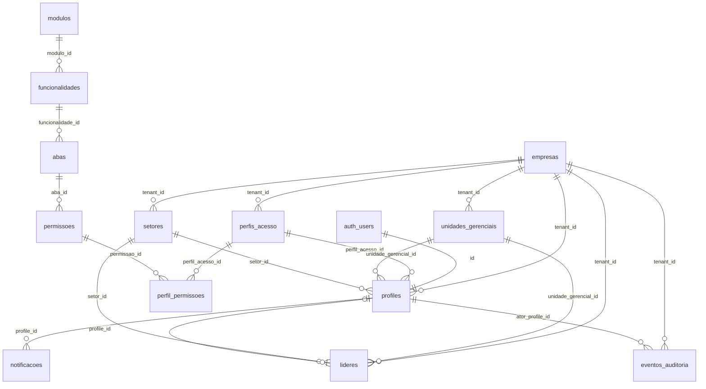

# Modelo de Dados — Maxis

> **Fonte única do schema.** Nenhuma migration diverge deste arquivo. Introduziu tabela/coluna numa fase? Atualize aqui **no mesmo commit** (`CLAUDE.md §3`).
> Cada entidade traz a **fase** em que nasce. Entidades de módulos de negócio estão **identificadas** (tenant + relações centrais) e serão **refinadas** quando a fase respectiva for planejada.

**Versão:** 1.5 · 02/11/2026 · v1 (18/10/2026, Etapa E) + ajustes dos planos das Fases 1 (RPC `obter_meu_acesso`, troca de senha por Edge Function), 4 (RPC `listar_empresas_admin`), 5 (RPCs de permissão, auditoria por trigger, regra do catálogo), 6 (refinamento da estrutura organizacional) e 8 (notificações)
**Estado do projeto Supabase `maxis`:** vazio (informado pelo Danilo). A confirmar via Supabase MCP: estado real, versão do Postgres e formato das chaves de API.

**Legenda de status por entidade:** `✅ Definida` (pronta para migration na fase indicada) · `🔄 A refinar` (identificada; colunas finais no plano da fase) · `💡 Candidata` (hipótese a validar; pode não existir)

---

## 1. Convenções aplicadas

### 1.1 Nomenclatura (`CLAUDE.md §6`)
- Tabela `snake_case` **plural**; coluna `snake_case`; FK `<tabela_singular>_id` (`setor_id`, `perfil_acesso_id`, `unidade_gerencial_id`).
- **Exceções fixadas pelo `CLAUDE.md`:**
  - `tenant_id` é a FK para `empresas.id` (o nome do conceito de isolamento, `§4`) — não `empresa_id`.
  - `profiles` mantém o nome em inglês (padrão Supabase + `CLAUDE.md §4`); FK = `profile_id`.
  - Colunas de rastro `created_at`, `updated_at`, `created_by`, `updated_by` em inglês (exemplo do próprio `§6`).
- FK com papel qualificado: `<papel>_<tabela_singular>_id` (ex.: `ator_profile_id`).
- Valores de enum, chaves de catálogo e códigos: minúsculos `snake_case`.

### 1.2 Tipos
| Uso | Tipo |
|---|---|
| PK | `uuid primary key default gen_random_uuid()` — se o projeto estiver em **Postgres 18+**, trocar o default para `uuidv7()` (ordenado no tempo, menos fragmentação). Exceção: `profiles.id` = `auth.users.id`. |
| Texto | `text` (sem `varchar(n)`); limites via `check` só quando há regra de negócio |
| Dinheiro | `numeric(14,2)` |
| Quantidade/medida | `numeric(14,3)` (peso kg, volume m³) |
| Data / instante | `date` / `timestamptz` (nunca `timestamp` sem fuso) |
| Booleano | `boolean not null default …` |
| Conjunto fechado e estável usado em RLS | `enum` do Postgres |
| Conjunto que cresce com módulos | `text` + `check` (lista ou formato) |

### 1.3 Regras estruturais
- **`tenant_id uuid not null`** em **toda** tabela de negócio/tenant, com FK `→ empresas(id) on delete restrict` e índice (ou índice composto iniciado por `tenant_id`).
- **Integridade entre tenants no banco:** toda tabela de tenant tem `unique (tenant_id, id)`, e FKs entre tabelas de tenant são **compostas** — `(tenant_id, setor_id) → setores(tenant_id, id)`. Impossibilita uma linha do tenant A apontar para um setor do tenant B, mesmo por bug em Edge Function com `service_role`. Quando precisar de `on delete set null`, usar a forma com lista de colunas (`on delete set null (setor_id)`, PG 15+) para não anular o `tenant_id`.
- **Toda FK é indexada.**
- **Exclusão:** cadastros usam **desativação** (`ativo = false`), não `delete` — preserva histórico e FKs. `delete` físico só onde explicitado (ex.: perfil sem usuários).
- **`updated_at`** mantido por trigger `private.set_updated_at()` em toda tabela que o possui.
- **RLS habilitada em 100% das tabelas** do schema `public`, sem exceção (inclusive catálogos globais).
- Agregações (contadores, dashboards, rankings) **só em views/RPCs** no Postgres (`CLAUDE.md §4`).
- O **objeto de menu** (config no frontend) é a origem do catálogo de permissões; um seed popula `modulos`/`funcionalidades`/`abas`/`permissoes` a partir dele. Item removido do menu → `ativo = false` no catálogo (nunca `delete`, para não quebrar `perfil_permissoes`).

---

## 2. Visão geral (núcleo da fundação)

| Domínio | Tabelas | Escopo | Fase |
|---|---|---|---|
| Tenant & identidade | `empresas`, `profiles` | tenant (empresas = o próprio tenant) | 1 |
| Rastro | `eventos_auditoria` | tenant (nulo em eventos do SaaS sem empresa) | 1 |
| Catálogo de permissões | `modulos`, `funcionalidades`, `abas`, `permissoes` | **global** | 5 |
| Perfis de acesso | `perfis_acesso`, `perfil_permissoes` | tenant | 5 |
| Estrutura organizacional | `unidades_gerenciais`, `setores`, `lideres` | tenant | 6 |
| Notificações | `notificacoes` | tenant (nulo para destinatário `super_admin`) | 8 |
| Negócio | `veiculos`, `transportadores`, fretes, produtividade… | tenant | backlog |

---

## 3. Tipos enumerados

| Tipo | Valores | Fase | Uso |
|---|---|---|---|
| `papel_usuario` | `super_admin`, `master_admin`, `admin`, `user` | 1 | `profiles.papel`; lido pelas funções de RLS |
| `acao_permissao` | `view`, `edit` | 5 | `permissoes.acao`; último segmento da chave `modulo.funcionalidade.aba.acao` |

---

## 4. Funções de apoio à RLS (schema `private`, não exposto pela API)

Todas `security definer`, `stable`, `set search_path = ''`; usadas nas policies **sempre** envolvidas em `(select …)` para avaliar uma vez por query. Grants e padrão de policy ficam em `supabase/CLAUDE.md`.

| Função | Retorno | Regra | Fase |
|---|---|---|---|
| `private.tenant_atual()` | `uuid` | `tenant_id` do usuário logado (`auth.uid()`). Retorna **`null`** se o profile estiver inativo, se a empresa estiver inativa (CNPJ bloqueado) ou se for `super_admin`. Consequência: usuário suspenso recebe **zero linhas** em qualquer tabela de tenant, mesmo com JWT válido — o gate comercial não vaza dados. | 1 |
| `private.papel_atual()` | `papel_usuario` | Papel do usuário logado; `null` se inativo / empresa inativa. | 1 |
| `private.is_super_admin()` | `boolean` | `true` se o usuário logado é `super_admin` ativo. | 1 |
| `private.tem_permissao(chave text)` | `boolean` | `true` para `master_admin` (acesso total implícito); para `admin`/`user`, verifica se o perfil vinculado contém a permissão. `super_admin` → `false` em dados de tenant. | 5 |
| `private.cnpj_valido(cnpj text)` | `boolean` | `immutable`; valida 14 dígitos + dígitos verificadores. Usada em `check`. | 1 |
| `private.set_updated_at()` | trigger | Atualiza `updated_at`. | 1 |
| `private.registrar_auditoria()` | trigger | Grava em `eventos_auditoria` as alterações de tabelas **escritas pelo cliente** (sob RLS), com ator = `auth.uid()` e tenant = tenant da linha. Roda como `security definer`, sem o cliente precisar de permissão de escrita em `eventos_auditoria`. Usado em `perfis_acesso` (Fase 5) e na estrutura organizacional (Fase 6). | 5 |

**RPCs públicas (schema `public`, chamáveis pelo app):**

| RPC | Retorno | Regra | Fase |
|---|---|---|---|
| `obter_meu_acesso()` | registro com `papel`, `nome`, `ativo`, `empresa_ativa`, `senha_provisoria` | Só o próprio usuário (`auth.uid()`). `security definer` justificado: o usuário inativo ou de empresa bloqueada precisa saber **que** está bloqueado sem enxergar mais nada. `execute` só para `authenticated`. `tem_perfil` entra na Fase 5. | 1 |
| `listar_empresas_admin(busca, situacao, limite, deslocamento)` | linhas com dados da empresa, `master_admin` (id, nome, e-mail, `senha_provisoria`), total de usuários ativos e total de registros | Só `super_admin` (checagem como primeira instrução; demais chamadores → erro de permissão). `security definer` justificado: contar usuários por empresa sem dar ao `super_admin` leitura sobre os profiles de tenant. Busca por razão social, nome fantasia ou dígitos do CNPJ; filtro ativas/bloqueadas; paginação. | 4 |
| `obter_meu_acesso()` — campo `tem_perfil` | `boolean` | `master_admin`/`super_admin` → verdadeiro; `admin`/`user` → tem `perfil_acesso_id`. | 5 |
| `listar_minhas_permissoes()` | `text[]` (chaves) | Permissões ativas do próprio usuário; `master_admin` → todas as ativas do catálogo. `security invoker`. Fonte do `usePermissao` no frontend. | 5 |
| `listar_perfis_acesso(busca)` | perfis do tenant + total de usuários vinculados | `security invoker` (a RLS limita ao tenant). | 5 |
| `salvar_perfil_acesso(id, nome, descricao, chaves)` | perfil salvo | Cria ou atualiza nome, descrição e conjunto de permissões **numa transação**; normaliza "editar implica visualizar"; chave inexistente/inativa → erro. `security invoker` — as policies exigem `master_admin`. | 5 |
| `listar_unidades_gerenciais(busca, situacao)` | unidades do tenant + usuários e líderes ativos vinculados | `security invoker` (RLS limita ao tenant). | 6 |
| `listar_setores(busca, situacao)` | setores do tenant + usuários e líderes ativos vinculados | `security invoker`. | 6 |
| `marcar_notificacoes_lidas(ids)` | quantidade marcada | Marca `lida_em` só nas notificações do próprio usuário (ids de outros são ignorados). `security invoker`. | 8 |
| `marcar_todas_notificacoes_lidas(tipo)` | quantidade marcada | Marca todas as não lidas do próprio usuário, opcionalmente de um tipo. `security invoker`. | 8 |

**Por que lookup em vez de claims no JWT:** bloqueio de CNPJ, desativação de usuário e troca de perfil precisam ter **efeito imediato**. Claims customizados no JWT só mudam no próximo refresh do token (até 1h). Com a função envolvida em `(select …)` + índice em `profiles.id`, o custo é uma leitura por query.

---

## 5. Entidades — núcleo da fundação

### 5.1 `empresas` — o tenant · `✅ Definida` · Fase 1

O `id` desta tabela **é** o `tenant_id` de todo o sistema. Não tem coluna `tenant_id`.

| Coluna | Tipo | Regras | Fase |
|---|---|---|---|
| `id` | `uuid` | PK — é o `tenant_id` | 1 |
| `razao_social` | `text` | `not null` | 1 |
| `nome_fantasia` | `text` | opcional; exibido na UI quando preenchido | 1 |
| `cnpj` | `text` | `not null`, **`unique`**, só dígitos (`^\d{14}$`), `check (private.cnpj_valido(cnpj))`. Atributo de identidade/exibição — **nunca** join nem filtro de segurança. | 1 |
| `ativo` | `boolean` | `not null default true`. `false` = CNPJ bloqueado → todos os usuários da empresa caem no gate "acesso suspenso". | 1 |
| `bloqueada_em` | `timestamptz` | preenchido ao bloquear; limpo ao desbloquear | 1 |
| `motivo_bloqueio` | `text` | opcional; visível só no Admin SaaS | 1 |
| `created_at` / `updated_at` | `timestamptz` | `not null default now()` | 1 |
| `created_by` | `uuid` | FK `→ profiles(id)` (o `super_admin` que cadastrou) | 1 |

- **RLS — leitura:** `super_admin` lê todas; usuário de tenant lê **só a própria** (`id = (select private.tenant_atual())`).
- **RLS — escrita:** nenhuma policy para `authenticated`. Cadastro, edição e bloqueio só via Edge Function (`service_role`) acionada pelo Admin SaaS (Fase 4), com registro em `eventos_auditoria`.

### 5.2 `profiles` — usuários · `✅ Definida` · Fases 1, 5, 6

Um registro por usuário de `auth.users`, criado pela Edge Function de provisionamento logo após `auth.admin.createUser` (`email_confirm: true`). Colunas que referenciam tabelas de fases posteriores nascem na fase da tabela referenciada.

| Coluna | Tipo | Regras | Fase |
|---|---|---|---|
| `id` | `uuid` | PK **e** FK `→ auth.users(id) on delete cascade` | 1 |
| `tenant_id` | `uuid` | FK `→ empresas(id)`. **Nulo se e somente se** `papel = 'super_admin'` (`check ((papel = 'super_admin') = (tenant_id is null))`) | 1 |
| `papel` | `papel_usuario` | `not null` | 1 |
| `nome` | `text` | `not null` | 1 |
| `email` | `text` | `not null`, `unique`, minúsculo — cópia de `auth.users.email` para listagens (o cliente não lê `auth.users`) | 1 |
| `telefone` | `text` | opcional; só dígitos (E.164 sem `+`) — usado para repassar a senha provisória por WhatsApp | 1 |
| `ativo` | `boolean` | `not null default true` — gate comercial individual | 1 |
| `senha_provisoria` | `boolean` | `not null default true` — força a troca no próximo login; volta a `true` em todo reset | 1 |
| `senha_alterada_em` | `timestamptz` | última troca feita pelo próprio usuário | 1 |
| `perfil_acesso_id` | `uuid` | FK composta `(tenant_id, perfil_acesso_id) → perfis_acesso(tenant_id, id) on delete restrict` — o `restrict` é o que **impede excluir perfil com usuários vinculados**. `null` = "sem perfil" → tela de alerta. | 5 |
| `unidade_gerencial_id` | `uuid` | FK composta `→ unidades_gerenciais(tenant_id, id)` | 6 |
| `setor_id` | `uuid` | FK composta `→ setores(tenant_id, id)` | 6 |
| `created_at` / `updated_at` | `timestamptz` | `not null default now()` | 1 |
| `created_by` / `updated_by` | `uuid` | FK `→ profiles(id)` | 1 |

**Regras (constraints/triggers):**
- **Um `master_admin` por empresa:** `unique (tenant_id) where papel = 'master_admin'`.
- **`super_admin` e `master_admin` não têm perfil** (acesso total implícito): `check (papel in ('admin','user') or perfil_acesso_id is null)`.
- **`admin` tem unidade gerencial obrigatória:** `check (papel <> 'admin' or unidade_gerencial_id is not null)` (Fase 6). `user` pode ter unidade/setor; `master_admin` e `super_admin` não têm (`check`).
- **`master_admin` imutável:** trigger impede alterar `papel`, `tenant_id` ou `ativo` de um `master_admin` exceto pelo caminho do Admin SaaS (Edge Function com `service_role`). Detalhe na Fase 1/7.
- `papel` e `tenant_id` nunca mudam por ação do próprio usuário.

**Índices:** `(tenant_id, papel)`, `(tenant_id, perfil_acesso_id)`, `(tenant_id, unidade_gerencial_id)`, `(tenant_id, setor_id)`, `unique (tenant_id, id)`.

- **RLS — leitura:** o próprio registro sempre; usuários do mesmo tenant (`tenant_id = (select private.tenant_atual())`) — necessário para listas de usuários, líderes e responsáveis; `super_admin` lê os `master_admin` (Admin SaaS).
- **RLS — escrita:** nenhuma policy e nenhum grant de escrita para o cliente. Criação, edição, reset e (des)ativação só via Edge Function. A troca da própria senha também: Edge Function `trocar-senha` (Fase 1), que troca a senha no Auth e só então marca `senha_provisoria = false` e `senha_alterada_em` — não há caminho para desmarcar a senha provisória sem trocá-la (pendência de governança #5 ajusta o texto do `CLAUDE.md §5`).

### 5.3 `eventos_auditoria` — rastro de ações privilegiadas · `✅ Definida` · Fase 1

Somente inserção (append-only). Gravada **apenas** por Edge Functions/RPCs privilegiadas. Sem tela na v1.

| Coluna | Tipo | Regras | Fase |
|---|---|---|---|
| `id` | `uuid` | PK | 1 |
| `tenant_id` | `uuid` | FK `→ empresas(id)`; empresa afetada; nulo só em evento do SaaS sem empresa | 1 |
| `ator_profile_id` | `uuid` | FK `→ profiles(id)`; quem executou; nulo = sistema | 1 |
| `acao` | `text` | `not null`, formato `^[a-z_]+\.[a-z_]+$` (`dominio.evento`) | 1 |
| `alvo_tabela` | `text` | tabela afetada (ex.: `profiles`) | 1 |
| `alvo_id` | `uuid` | id do registro afetado | 1 |
| `detalhes` | `jsonb` | contexto (antes/depois relevantes). **Nunca** senha, token ou chave. | 1 |
| `created_at` | `timestamptz` | `not null default now()` | 1 |

**Ações iniciais** (a lista cresce por fase; registrar aqui): `empresa.criada`, `empresa.atualizada`, `empresa.bloqueada`, `empresa.desbloqueada` (Fase 4) · `usuario.criado`, `usuario.senha_alterada` (Fase 1) · `usuario.senha_resetada`, `usuario.ativado`, `usuario.desativado`, `usuario.atualizado` (Fases 4, 7) · `perfil.criado`, `perfil.atualizado`, `perfil.excluido` (Fase 5) · `unidade_gerencial.criada`, `unidade_gerencial.atualizada`, `unidade_gerencial.desativada`, `unidade_gerencial.reativada`, `setor.criado`, `setor.atualizado`, `setor.desativado`, `setor.reativado`, `lider.criado`, `lider.atualizado`, `lider.desativado`, `lider.reativado` (Fase 6).

- **Índices:** `(tenant_id, created_at desc)`, `(ator_profile_id)`, `(alvo_tabela, alvo_id)`.
- **RLS — leitura:** `super_admin` lê todos; `master_admin` lê os do próprio tenant (tela futura).
- **RLS — escrita:** nenhuma policy; `update`/`delete` bloqueados também por trigger (imutável inclusive para `service_role`).

---

## 6. Entidades — perfis de acesso e permissões (Fase 5)

### 6.1 Catálogo global: `modulos` → `funcionalidades` → `abas` → `permissoes` · `✅ Definida` · Fase 5

Espelho do objeto de menu. **Sem `tenant_id`** — o menu do produto é o mesmo para todas as empresas. Populado por migration gerada a partir do config (Fase 5); nunca editado pela UI.

**Entram no catálogo só os itens concedíveis por perfil:** disponíveis (não "em breve") e **sem restrição de papel**. Itens restritos — Admin SaaS (`super_admin`), Perfis de Acesso e Usuários (`master_admin`) — ficam fora e são liberados pelo papel, nunca por perfil.

| Tabela | Colunas | Regras |
|---|---|---|
| `modulos` | `id`, `chave text`, `nome text`, `ordem int`, `ativo boolean`, `created_at`, `updated_at` | `unique (chave)`; `chave` = 1º segmento da rota (`/operacoes`) |
| `funcionalidades` | `id`, `modulo_id`, `chave`, `nome`, `ordem`, `ativo`, `created_at`, `updated_at` | `unique (modulo_id, chave)`; FK indexada |
| `abas` | `id`, `funcionalidade_id`, `chave`, `nome`, `ordem`, `ativo`, `created_at`, `updated_at` | `unique (funcionalidade_id, chave)`; **toda funcionalidade tem ≥ 1 aba** (mesmo que única), pois a rota é sempre `/modulo/funcionalidade/aba` |
| `permissoes` | `id`, `aba_id`, `acao acao_permissao`, `chave text`, `created_at` | `unique (aba_id, acao)`; `unique (chave)`; `chave` no formato `^[a-z0-9_]+\.[a-z0-9_]+\.[a-z0-9_]+\.(view\|edit)$` (ex.: `operacoes.gestao.pedidos.edit`) |

- **RLS:** leitura para `authenticated`; nenhuma escrita (só seed/migration).

### 6.2 `perfis_acesso` · `✅ Definida` · Fase 5

| Coluna | Tipo | Regras |
|---|---|---|
| `id` | `uuid` | PK; `unique (tenant_id, id)` |
| `tenant_id` | `uuid` | `not null`, FK `→ empresas(id)` |
| `nome` | `text` | `not null`; `unique (tenant_id, lower(nome))` |
| `descricao` | `text` | opcional |
| `created_at` / `updated_at` | `timestamptz` | `not null default now()` |
| `created_by` / `updated_by` | `uuid` | FK `→ profiles(id)` |

- **Exclusão física permitida só sem usuários vinculados** — garantida pela FK `restrict` em `profiles.perfil_acesso_id`; a UI mostra o bloqueio de forma amigável.
- **RLS — leitura:** mesmo tenant. **Escrita:** só `master_admin` do tenant, por policies com `private.papel_atual()`; a UI salva pela RPC `salvar_perfil_acesso()` (`security invoker`, atômica). Auditoria por trigger `private.registrar_auditoria()`.

### 6.3 `perfil_permissoes` · `✅ Definida` · Fase 5

| Coluna | Tipo | Regras |
|---|---|---|
| `tenant_id` | `uuid` | `not null`; parte da FK composta |
| `perfil_acesso_id` | `uuid` | FK composta `(tenant_id, perfil_acesso_id) → perfis_acesso(tenant_id, id) on delete cascade` |
| `permissao_id` | `uuid` | FK `→ permissoes(id) on delete restrict` |
| `created_at` | `timestamptz` | `not null default now()` |

- PK `(perfil_acesso_id, permissao_id)`; índices `(tenant_id)`, `(permissao_id)`.
- **`edit` implica `view`:** garantido por trigger (conceder `…edit` cria a `…view` da mesma aba; retirar a `…view` retira a `…edit`) e normalizado também pela RPC `salvar_perfil_acesso()`.
- **RLS:** igual a `perfis_acesso`.

---

## 7. Entidades — estrutura organizacional (Fase 6)

Unidade gerencial e setor são **atributos de filtro/agrupamento/relatório** — **não** são parede de RLS na v1 (`CLAUDE.md §4`).

### 7.1 `unidades_gerenciais` · `✅ Definida` · Fase 6

| Coluna | Tipo | Regras |
|---|---|---|
| `id` | `uuid` | PK; `unique (tenant_id, id)` |
| `tenant_id` | `uuid` | `not null`, FK `→ empresas(id)` |
| `nome` | `text` | `not null`; `unique (tenant_id, lower(nome))` |
| `codigo` | `text` | opcional; `unique (tenant_id, codigo)` quando preenchido |
| `cidade` | `text` | `not null` (texto livre na v1, sem tabela de municípios) |
| `uf` | `text` | `not null`; `check` com as 27 siglas (`AC` … `TO`) |
| `ativo` | `boolean` | `not null default true` |
| `created_at` / `updated_at` / `created_by` / `updated_by` | — | padrão |

Backlog: endereço completo e CNPJ de filial, quando um módulo de negócio precisar.

### 7.2 `setores` · `✅ Definida` · Fase 6

**Decisão proposta:** setores são **do tenant, independentes de unidade** — "Expedição" é o mesmo setor em qualquer unidade. Por isso as tabelas de negócio carregam `unidade_gerencial_id` **e** `setor_id` como atributos separados.

| Coluna | Tipo | Regras |
|---|---|---|
| `id` | `uuid` | PK; `unique (tenant_id, id)` |
| `tenant_id` | `uuid` | `not null`, FK `→ empresas(id)` |
| `nome` | `text` | `not null`; `unique (tenant_id, lower(nome))` |
| `ativo` | `boolean` | `not null default true` |
| `created_at` / `updated_at` / `created_by` / `updated_by` | — | padrão |

### 7.3 `lideres` · `✅ Definida` · Fase 6

Cadastro próprio de líderes, **com login opcional**: cobre líderes operacionais sem acesso ao sistema (base para Produtividade e Campeões) e líderes que também são usuários.

| Coluna | Tipo | Regras |
|---|---|---|
| `id` | `uuid` | PK; `unique (tenant_id, id)` |
| `tenant_id` | `uuid` | `not null`, FK `→ empresas(id)` |
| `nome` | `text` | `not null` |
| `unidade_gerencial_id` | `uuid` | `not null`; FK composta `→ unidades_gerenciais(tenant_id, id)` |
| `setor_id` | `uuid` | `not null`; FK composta `→ setores(tenant_id, id)` |
| `profile_id` | `uuid` | opcional; FK composta `(tenant_id, profile_id) → profiles(tenant_id, id)`; `unique (profile_id)` — um usuário é no máximo um líder |
| `telefone` | `text` | opcional; só dígitos |
| `ativo` | `boolean` | `not null default true` |
| `created_at` / `updated_at` / `created_by` / `updated_by` | — | padrão |

- Um líder responde por **um setor numa unidade**; quem lidera dois setores tem dois cadastros.

**Regras da estrutura (7.1–7.3):**
- **RLS:** leitura no mesmo tenant; inserção e alteração para quem tiver a permissão `configuracoes.estrutura.<aba>.edit` (`private.tem_permissao`, verdadeiro para o `master_admin`); nenhuma exclusão física.
- **Vínculo ativo:** trigger garante que um vínculo **novo ou alterado** em `profiles` ou `lideres` só aponte para unidade e setor ativos. Desativar unidade/setor não mexe nos vínculos existentes (histórico).
- **Auditoria:** trigger `private.registrar_auditoria()` (ações em §5.3).

---

## 8. Notificações (Fase 8)

### 8.1 `notificacoes` · `✅ Definida` · Fase 8

Uma linha **por destinatário** (fan-out na criação — volume baixo, 5–100 usuários por tenant).

| Coluna | Tipo | Regras |
|---|---|---|
| `id` | `uuid` | PK |
| `tenant_id` | `uuid` | FK `→ empresas(id)`; espelha o tenant do destinatário (nulo só para `super_admin`) |
| `profile_id` | `uuid` | `not null`, FK `→ profiles(id) on delete cascade` — destinatário |
| `tipo` | `text` | `not null`, `check` com lista fechada (filtro da UI). v1: só `seguranca`; a lista cresce por migration a cada aviso novo |
| `titulo` | `text` | `not null` |
| `mensagem` | `text` | `not null` |
| `link` | `text` | opcional; rota interna `/modulo/funcionalidade/aba` |
| `lida_em` | `timestamptz` | `null` = não lida |
| `created_at` | `timestamptz` | `not null default now()` |

- **Índices:** `(profile_id, created_at desc)`; parcial `(profile_id) where lida_em is null` (contador do sino).
- **RLS — leitura:** só o destinatário (`profile_id = (select auth.uid())`), desde que ativo e com empresa ativa (via funções da §4). Contador e lista lidos direto da tabela.
- **Escrita:** criação só pela Edge Function que causa o evento (cliente admin). O destinatário altera **apenas a coluna `lida_em`** das próprias linhas (grant de coluna `update (lida_em)` + policy `notificacoes_update_destinatario`), pelas RPCs de leitura da §4. Nenhuma exclusão pelo cliente.
- **Avisos da v1:** "Sua senha foi alterada" (`seguranca`, após troca voluntária). Backlog: usuário sem perfil tentou entrar, primeiro acesso concluído, perfil de acesso alterado.

---

## 9. Entidades de negócio (backlog) — identificadas, a refinar

**Padrão obrigatório de toda tabela de negócio:**
- Colunas base: `id`, `tenant_id not null`, `unidade_gerencial_id`, `setor_id` (obrigatoriedade definida por tabela), `ativo` (cadastros), `created_at`, `updated_at`, `created_by`, `updated_by`.
- `unique (tenant_id, id)` + FKs compostas para outras tabelas de tenant.
- **RLS — leitura:** `tenant_id = (select private.tenant_atual())`.
- **RLS — escrita (decisão proposta, defesa em profundidade):** além do tenant, exige `(select private.tem_permissao('<modulo>.<funcionalidade>.<aba>.edit'))`. A permissão continua definindo *quais telas* — mas uma chamada direta à API sem permissão de edição também é barrada no banco. Nenhuma filtragem de *linhas* além do tenant.

### 9.1 Cadastros · Fase de negócio a definir (sugestão: primeira após a fundação)

**`transportadores`** · `🔄 A refinar`

| Coluna | Tipo | Regras |
|---|---|---|
| `id`, `tenant_id` | `uuid` | padrão |
| `razao_social` | `text` | `not null` |
| `nome_fantasia` | `text` | opcional |
| `cnpj` | `text` | só dígitos + `private.cnpj_valido`; `unique (tenant_id, cnpj)` — atributo, não chave de segurança |
| `ativo` | `boolean` | padrão |

`🔄` Contatos, endereço, RNTRC/ANTT, dados bancários.

**`veiculos`** · `🔄 A refinar`

| Coluna | Tipo | Regras |
|---|---|---|
| `id`, `tenant_id` | `uuid` | padrão |
| `unidade_gerencial_id` | `uuid` | FK composta |
| `transportador_id` | `uuid` | FK composta `→ transportadores`; nulo = frota própria |
| `placa` | `text` | `not null`, maiúscula, `^[A-Z]{3}[0-9][A-Z0-9][0-9]{2}$` (antiga e Mercosul); `unique (tenant_id, placa)` |
| `tipo_veiculo` | `text` | `check` com lista (VUC, toco, truck, carreta, bitrem…) — `🔄` lista final na fase |
| `capacidade_kg` / `capacidade_m3` | `numeric(14,3)` | opcionais, `> 0` |
| `ativo` | `boolean` | padrão |

### 9.2 Fretes (Simulador · Tabela de Fretes · Gestão de Fretes · Parâmetros de Cálculo) · `🔄 A refinar`

| Tabela | Relações centrais | Observação |
|---|---|---|
| `tabelas_frete` | `tenant_id`, `transportador_id`, `unidade_gerencial_id` | vigência (`vigencia_inicio`/`vigencia_fim`), `ativo` |
| `itens_tabela_frete` | `tenant_id`, `tabela_frete_id` | faixas origem/destino/peso → valor (`numeric(14,2)`) |
| `parametros_calculo_frete` | `tenant_id`, `unidade_gerencial_id` | componentes (ad valorem, GRIS, pedágio, impostos…) |
| `fretes` | `tenant_id`, `unidade_gerencial_id`, `setor_id`, `transportador_id`, `veiculo_id`, `tabela_frete_id` | gestão: data, origem, destino, peso, valor calculado × cobrado, status |

`💡` **Simulador:** RPC de cálculo sem persistência (nenhuma tabela) — confirmar se o histórico de simulações deve ser salvo.

### 9.3 Produtividade (Armazém · Transporte) e Campeões · `🔄 A refinar`

| Tabela | Relações centrais | Observação |
|---|---|---|
| `parametros_produtividade` | `tenant_id`, `unidade_gerencial_id`, `setor_id` | indicador, unidade de medida, meta |
| `apontamentos_produtividade` | `tenant_id`, `unidade_gerencial_id`, `setor_id`, `lider_id` | data, indicador, quantidade realizada |
| *Ranking de Campeões* | — | **view** agregada no Postgres sobre os apontamentos (sem tabela própria) |

### 9.4 Dados de Rota · Dados de Armazém (dashboards) · `💡 Candidata`

Fonte dos dados ainda não definida (importação de planilha? integração?). Hipóteses a validar quando a fase for planejada: `viagens`, `entregas`, `motoristas`, `movimentacoes_armazem`. Dashboards consomem **views/RPCs**, nunca linhas cruas.

### 9.5 SaaS / assinatura · `💡 Candidata`

`planos`, `assinaturas`, `empresa_modulos` (habilitação de módulos por empresa conforme o plano). Fora da fundação; o gate comercial da v1 é `empresas.ativo` + `profiles.ativo`.

---

## 10. Matriz de RLS (resumo)

| Tabela | Leitura | Escrita |
|---|---|---|
| `empresas` | `super_admin`: todas · tenant: a própria | só Edge Function (`service_role`) |
| `profiles` | próprio · mesmo tenant · `super_admin`: `master_admin`s | só Edge Function (inclusive a troca da própria senha, `trocar-senha`) |
| `eventos_auditoria` | `super_admin`: todos · `master_admin`: do tenant | só funções privilegiadas; imutável |
| `modulos`/`funcionalidades`/`abas`/`permissoes` | `authenticated` | só seed/migration |
| `perfis_acesso`, `perfil_permissoes` | mesmo tenant | `master_admin` do tenant |
| `unidades_gerenciais`, `setores`, `lideres` | mesmo tenant | `master_admin` ou `tem_permissao(…edit)` |
| `notificacoes` | só o destinatário | criação privilegiada; destinatário marca leitura via RPC |
| tabelas de negócio | mesmo tenant | mesmo tenant + `tem_permissao(…edit)` |

Toda leitura de tenant passa por `private.tenant_atual()` → usuário inativo ou empresa bloqueada = **zero linhas**.

---

## 11. Ordem de criação por fase (migrations)

| Fase | Objetos |
|---|---|
| 1 | schema `private`; `papel_usuario`; `private.cnpj_valido`, `private.set_updated_at`, `private.tenant_atual`, `private.papel_atual`, `private.is_super_admin`; `empresas`; `profiles` (colunas da Fase 1) + trigger de imutabilidade do `master_admin`; `eventos_auditoria`; RPC `obter_meu_acesso()`; RLS + testes de isolamento |
| 2–3 | sem mudanças de schema |
| 4 | RPC `listar_empresas_admin()` (sem tabelas novas) |
| 5 | `acao_permissao`; `modulos`, `funcionalidades`, `abas`, `permissoes` (migration gerada do menu-config); `perfis_acesso`, `perfil_permissoes`; `profiles.perfil_acesso_id`; `private.tem_permissao`, `private.registrar_auditoria`; RPCs `listar_minhas_permissoes`, `listar_perfis_acesso`, `salvar_perfil_acesso`; `obter_meu_acesso` + `tem_perfil` |
| 6 | `unidades_gerenciais`, `setores`, `lideres`; `profiles.unidade_gerencial_id`, `profiles.setor_id` (+ checks por papel e trigger de vínculo ativo); RPCs `listar_unidades_gerenciais`, `listar_setores`; catálogo regenerado com a Estrutura |
| 7 | sem tabelas novas previstas (regras de imutabilidade/ativação sobre `profiles`) |
| 8 | `notificacoes` (tipo inicial `seguranca`, grant de coluna `lida_em`) + RPCs `marcar_notificacoes_lidas`, `marcar_todas_notificacoes_lidas` |

---

## 12. Decisões propostas (revisar na aprovação)

1. PK `uuid` com `gen_random_uuid()`; `uuidv7()` se o projeto estiver em PG 18+.
2. `papel_usuario` como enum; catálogo de permissões **global**; perfis **por tenant**.
3. **Um perfil por usuário** (`profiles.perfil_acesso_id`; `null` = sem perfil).
4. `master_admin` e `super_admin` com acesso total implícito, **sem perfil** (`check`).
5. `super_admin` com `tenant_id` nulo (`check`); não enxerga dados de tenant por RLS. *(decidido pelo Danilo)*
6. Bloqueio de CNPJ = `empresas.ativo = false`; `private.tenant_atual()` devolve `null` para usuário/empresa inativos (gate sem vazamento).
7. Tenant resolvido por **lookup** (efeito imediato), não por claim no JWT.
8. **FKs compostas com `tenant_id`** entre tabelas de tenant (integridade cross-tenant no banco).
9. `admin` com unidade gerencial obrigatória; `user` com unidade/setor opcionais; `master_admin` sem unidade.
10. **Setores independentes de unidade** (do tenant).
11. `lideres` como cadastro próprio com `profile_id` opcional. *(decidido pelo Danilo)*
12. `eventos_auditoria` append-only na fundação, sem tela na v1. *(decidido pelo Danilo)*
13. Escrita em tabelas de negócio exige `tem_permissao(…edit)` no banco (defesa em profundidade).
14. `profiles.telefone` opcional para o repasse da senha provisória.

## 13. Estado dos projetos Supabase (confirmado via MCP no STEP 0.10, 07/11/2026)

- `maxis` (desenvolvimento, us-west-2) e `maxis-producao` (produção, sa-east-1): vazios — nada em `public`, nenhuma migration, nenhum usuário no Auth.
- Postgres **17.11** nos dois (mesma major) → PK com `gen_random_uuid()`; `uuidv7()` só quando os dois estiverem em PG 18+.
- Extensões iguais nos dois: `pg_stat_statements`, `pgcrypto`, `plpgsql`, `supabase_vault`, `uuid-ossp`. O pgTAP (1.3.3 disponível) só existe durante os testes.
- Privilégios padrão iguais nos dois: tabela, sequência e função nova em `public` nasce com grant para `anon` e `authenticated`. Por isso toda migration revoga de `anon` e concede o mínimo (`supabase/CLAUDE.md §5`); o teste guardião acusa o que escapar.
- O dev nasceu com a RLS automática (event trigger `ensure_rls` + `public.rls_auto_enable()`); a produção, não. Removida pela migration `f00_remove_rls_automatica`: a RLS é sempre explícita na migration da tabela, igual nos dois projetos.
- Chaves de API: as duas famílias nasceram ativas nos dois projetos. O Maxis usa só as novas (`sb_publishable_…` / `sb_secret_…`); as legadas ficam desativadas (pendência #3).
